<div align="center">

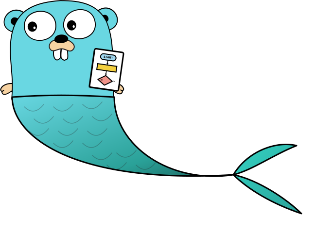

# mmdg

**Mermaid diagrams in pure Go. No browser. The same SVG as mermaid, byte for byte.**

[](https://github.com/bvolpato/mermaid-go-renderer/actions/workflows/ci.yml)
[](https://pkg.go.dev/github.com/bvolpato/mermaid-go-renderer)
[](https://github.com/bvolpato/mermaid-go-renderer/releases/latest)
[](LICENSE)

[Website](https://bvolpato.github.io/mermaid-go-renderer/) · [Playground](https://bvolpato.github.io/mermaid-go-renderer/#play) · [Command line](docs/CLI.md) · [Architecture](docs/ARCHITECTURE.md)

</div>

`mmdg` is a Go library and a command-line tool that render [Mermaid](https://mermaid.js.org) diagrams to SVG, PNG, and vector PDF. It is a port of mermaid 12.2.0: the same parsers, the same layout engines and the same markup, with text measurement that reproduces Chromium. It does not start a browser and it has no cgo.

<p align="center">
  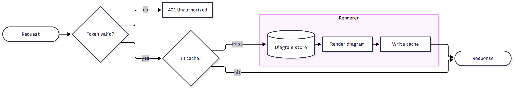
</p>

<!-- generated:speed start -->
<p align="center">
  <picture>
    <source media="(prefers-color-scheme: dark)" srcset="docs/assets/speed-dark.svg">
    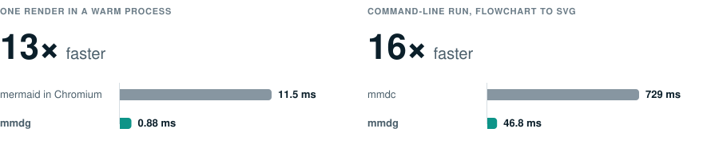
  </picture>
</p>
<!-- generated:speed end -->

```go
svg, err := mermaid.Render("flowchart LR\n  A[Start] --> B{Done?}\n  B -->|yes| C[Stop]")
```

```sh
mmdg -i diagram.mmd -o diagram.svg
```

## Why

Mermaid needs a browser. `mermaid-cli` starts headless Chromium for every run. That is slow, heavy in a container and hard to call from a Go service.

A renderer without a browser can replace mermaid only if its output is the same. A diagram that looks similar is not enough, because a small difference in one text width moves nodes and edges. So this project has one measure: the SVG text must have the same bytes as the SVG that `mermaid.render()` returns in Chromium.

## Result

<!-- generated:result start -->
<p align="center">
  <picture>
    <source media="(prefers-color-scheme: dark)" srcset="docs/assets/parity-dark.svg">
    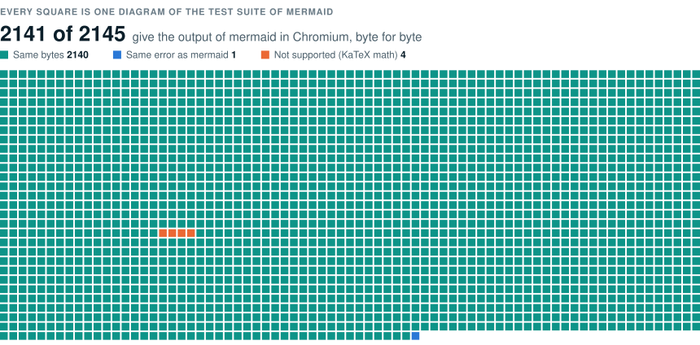
  </picture>
</p>

`mmdg` can replace two things, and each has its own proof.

**`mermaid.render()` in a web page.** This is the default of the library.

| Corpus | Diagrams | Pass | Byte-exact | Same error as mermaid |
|---|---:|---:|---:|---:|
| The end-to-end tests of mermaid | 2145 | 2143 (99.9%) | 2142 | 1 |
| The examples of the mermaid documentation | 596 | 594 (99.7%) | 576 | 18 |
| Generated large diagrams, 15 to 150 nodes | 70 | 70 (100.0%) | 70 | 0 |

- "Pass" means byte-exact output, or matching errors when the reference also rejects a diagram.
- The corpora cover Mermaid's end-to-end tests, its documentation examples, and generated large diagrams.
- The table is for Chromium 156 on Linux with the Liberation fonts. Against Chromium 156 on macOS with the system fonts, 2141, 594 and 70 diagrams pass.

**The `mmdc` command of mermaid-cli 12.** This is the default of the `mmdg` command. `mmdc` renders in a page of its own, with web fonts that a plain page has not (see [Pages](#pages)), and it writes the SVG as XML with the fonts embedded.

| Corpus | Diagrams | Pass on Linux | Pass on macOS |
|---|---:|---:|---:|
| The end-to-end tests of mermaid | 2145 | 2143 (99.9%) | 2134 (99.5%) |
| The examples of the mermaid documentation | 596 | 594 (99.7%) | 594 (99.7%) |
| Generated large diagrams, 15 to 150 nodes | 70 | 70 (100.0%) | 70 (100.0%) |

- "Pass" means that both files of `mmdc` have the same bytes, or that both tools report an error for a diagram.
- On macOS, 9 more diagrams do not match both mmdc output files.
<!-- generated:result end -->

You can check this yourself. The repository has the SHA-256 of every reference SVG, and one test compares them:

```sh
go test -run TestCorpusParity .
```

The tables by diagram type are in [docs/PARITY.md](docs/PARITY.md), [docs/PARITY-DOCS.md](docs/PARITY-DOCS.md) and [docs/PARITY-LARGE.md](docs/PARITY-LARGE.md) for the Linux reference, and in [docs/PARITY-MACOS.md](docs/PARITY-MACOS.md) for the macOS reference. The tables for `mmdc` are in [docs/PARITY-MMDC.md](docs/PARITY-MMDC.md) and [docs/PARITY-MMDC-MACOS.md](docs/PARITY-MMDC-MACOS.md). [docs/ARCHITECTURE.md](docs/ARCHITECTURE.md) explains how the references are made and how you can make them again.

The test also runs in a container with no fonts and no browser, because the default fonts are part of the module.

## Performance

<!-- generated:performance start -->
| Measurement | mermaid in Chromium | mmdg | Ratio |
|---|---:|---:|---:|
| One render in a warm process, median of 2076 diagrams | 11.5 ms | 0.88 ms | 13x |
| The same, 90th percentile | 25.8 ms | 2.55 ms | 10x |
| Command-line run, flowchart to SVG (`mmdc` and `mmdg`) | 729 ms | 46.8 ms | 16x |
| Command-line run, flowchart to PNG | 711 ms | 52.5 ms | 14x |

- The first two rows compare `mermaid.render()` in a Chromium page that stays open with `mermaid.Render` in a Go process that stays running. Both sides are warm.
- The last two rows compare whole processes. `mmdc` starts a browser in each run.
- The benchmark ran on 2026-11-09 with Mermaid 12.2.0 and mermaid-cli 12.0.0. [docs/PERFORMANCE.md](docs/PERFORMANCE.md) gives the method and timings by diagram type.
<!-- generated:performance end -->

## Gallery

`mmdg` rendered these images, with the fonts that mermaid-cli uses. The [website](https://bvolpato.github.io/mermaid-go-renderer/#gallery) has more, and a playground that runs the renderer in your browser.

<table>
  <tr>
    <td align="center">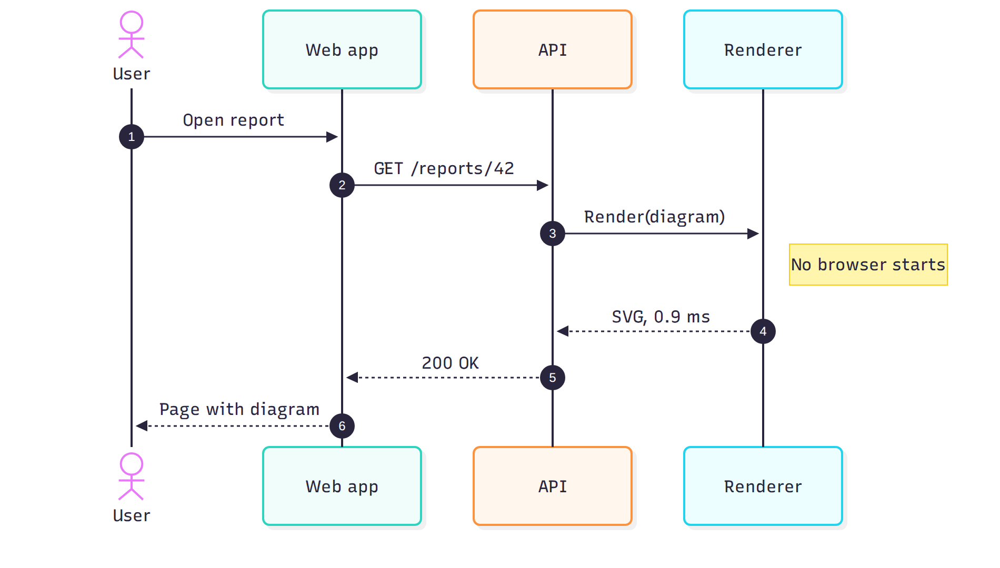</td>
    <td align="center">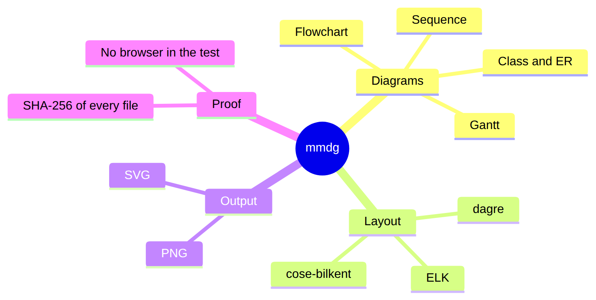</td>
  </tr>
  <tr>
    <td align="center">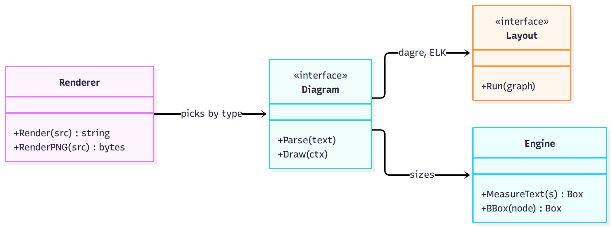</td>
    <td align="center">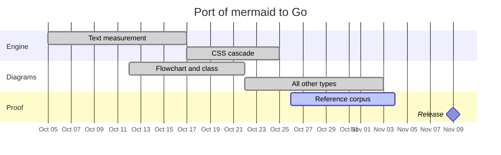</td>
  </tr>
  <tr>
    <td align="center">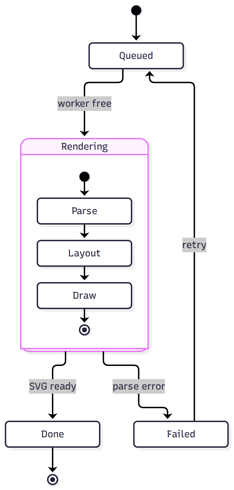</td>
    <td align="center">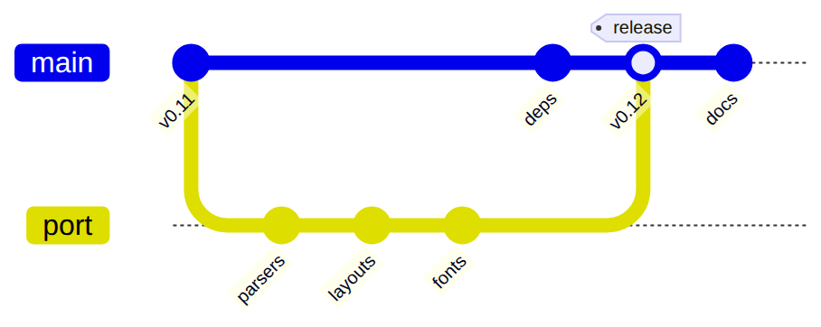</td>
  </tr>
</table>

The sources are in [website/diagrams](website/diagrams). `go run ./tools/sitegen -readme docs/assets` makes the images again.

## Install

The library:

```sh
go get github.com/bvolpato/mermaid-go-renderer
```

Install the command with Go or Homebrew, or download a binary archive from the [latest release](https://github.com/bvolpato/mermaid-go-renderer/releases/latest):

```sh
go install github.com/bvolpato/mermaid-go-renderer/cmd/mmdg@latest
brew install bvolpato/tap/mmdg
```

`mmdg --version` prints the installed mmdg version and its Mermaid version. The renderer follows Mermaid 12.2.0. The reference tools pin mermaid-cli 12.2.0 separately from the mmdg release version.

The module needs Go 1.27 or newer. A few case mappings and character classes come from the Unicode tables of the Go release, and Go 1.27 has the Unicode version of Chromium 156. With an older release, a label with one of the newest Unicode characters can differ from mermaid.

## Use the library

```go
import mermaid "github.com/bvolpato/mermaid-go-renderer"

src := "flowchart LR\n  A[Start] --> B{Done?}\n  B -->|yes| C[Stop]"
svg, err := mermaid.Render(src)

png, err := mermaid.RenderPNG(src, mermaid.WithScale(2))
pdf, err := mermaid.RenderPDF(src, mermaid.WithPDFPaperFormat("A4"))
pdfFromSVG, err := mermaid.SVGToPDF(svg)
```

Config works as in mermaid. Front matter and directives in the diagram text apply, and a site config stands for the argument of `mermaid.initialize`:

```go
svg, err := mermaid.Render(src,
	mermaid.WithConfigJSON([]byte(`{"theme": "dark", "look": "classic"}`)),
	mermaid.WithID("diagram-1"),
)
```

| API or option | Effect |
|---|---|
| `WithConfigJSON`, `WithConfig`, `WithTheme` | The site config of mermaid. |
| `WithID` | The id of the `svg` element. The default is `my-svg`, as in mermaid-cli. |
| `WithViewportWidth` | The width of the page that the layout assumes. The default is 800 px. |
| `WithTime`, `WithRandomSeed` | The clock and the random numbers. Both have fixed defaults. |
| `WithSystemFonts`, `WithFontDirs` | The fonts that measure text. See below. |
| `WithPage`, `WithFontEmbed` | The web page that the render reproduces, and the embedded fonts of `StandaloneSVG`. See [Pages](#pages). |
| `WithImageSize` | The natural size of images that a diagram names by URL. |
| `WithScale`, `WithBackground`, `WithBackgroundColor` | The pixel density and the background of PNG output. `WithBackgroundColor` takes a CSS color and also applies to `StandaloneSVG`. |
| `RenderPDF`, `SVGToPDF` | Render Mermaid source or convert an SVG to vector PDF. Use the same page, fonts, and viewport options for `SVGToPDF` as for the SVG render. |
| `WithPDFPaperFormat` | Set a paper size for PDF output. Without it, the page fits the diagram. |

For a service:

- `Render` is safe for concurrent use. A test renders the corpus from many goroutines with the race detector.
- The result depends only on the source and the options. The clock and the random numbers are fixed unless you set them.
- `RenderContext` stops when its context is done. Use a deadline for input that you do not trust.
- A defect in the renderer returns as an `*InternalError`. It does not stop your program.
- `StandaloneSVG` turns the result into a file that an image viewer or an XML parser reads. The string that `Render` returns is HTML markup, as in mermaid: a `<br>` in a label has no end tag.
- PDF output uses vector paths and TrueType fonts or Type 3 glyph subsets where possible. Unsupported fonts become outlines, and some contextual glyphs or ligatures may not extract as the original text. Drop shadows are flat silhouettes. Other filter graphs and image elements, including data URLs, are omitted.
- The renderer never reads from the network. An image in a label needs `WithImageSize`, or a data URL.

## Use the command line

`mmdg` takes the options of `mmdc` (mermaid-cli 12, and the options that mermaid-cli 11 had):

```sh
mmdg -i diagram.mmd -o diagram.svg
mmdg -i diagram.mmd -o diagram.png -s 2
mmdg -i diagram.mmd -e pdf -o diagram.pdf --pdf-paper-format A4
mmdg -i README.md -o out.svg                    # one file for each mermaid block
mmdg -i README.md -o README.out.md -a images    # Markdown with images in place of the blocks
cat diagram.mmd | mmdg -i - -o - -e svg > diagram.svg
```

It writes SVG and PNG files in the formats that `mmdc` writes. It also writes vector PDF without a browser. PDF paper size defaults to the size of the diagram. Use `--pdf-paper-format` to select a fixed paper size.

- `--no-font-embed` writes the SVG without the font data, as in `mmdc`.
- `--page plain` renders as mermaid does in a page without the web fonts.

[docs/CLI.md](docs/CLI.md) has every option, what was compared with real `mmdc` runs, and the remaining differences. Icon packs are not supported.

## Fonts and reproducible output

Mermaid measures text to lay out a diagram, so the fonts decide the result.

By default `mmdg` measures with fonts that are part of the module: Liberation Sans, Serif and Mono, which have the metrics of Arial, Times New Roman and Courier New. It applies the rules of Chromium on Linux. It reads no font file, so it gives the same SVG on a laptop and in a container that has no fonts. The reference for this mode is mermaid in Chromium on Linux with only the Liberation fonts installed.

- `WithFontDirs` adds font files for text that the Liberation fonts have no glyphs for, such as Chinese, Japanese, Korean and emoji.
- `WithSystemFonts` measures with the fonts of the machine, by the rules of Chromium on that operating system. The result then matches mermaid in a browser on the same machine. It is verified on macOS.

An SVG of mermaid has HTML labels in boxes of a fixed width, which is the width that the renderer measured. A viewer on another platform, or without the font, can measure a label a little wider, and the label then wraps. This is the same for an SVG that mermaid or `mmdc` made on another machine. When you do not know the viewers, use PNG output, or set `htmlLabels: false` in the config.

## Pages

The page that mermaid runs in also decides the result. In mermaid 12 the default theme of flowcharts, class diagrams, sequence diagrams and other types names the font `Recursive Variable`. A plain web page has no such font, so Chromium falls back to Arial. The page of `mmdc` loads the font, with Open Sans and Font Awesome, so the same diagram has another layout there.

| Page | Fonts and integrations | Who uses it |
|---|---|---|
| `PagePlain` | No web fonts or ZenUML plugin | The library by default. It gives what `mermaid.render()` returns in a page that has only mermaid. |
| `PageMermaidCLI` | Recursive Variable, Open Sans, Font Awesome, KaTeX styles, and the ZenUML plugin | The `mmdg` command by default. It gives what `mmdc` writes. An icon such as `fa:fa-car` shows; the `tidy-tree` layout and ZenUML diagram type are available. |

KaTeX math in `$$...$$` labels renders in both page modes. ZenUML is a diagram type available only on `PageMermaidCLI`, which registers the plugin used by `mmdc`. `PagePlain` does not register that plugin and follows Mermaid's plain-page behavior.

For example, render a math label with either page mode:

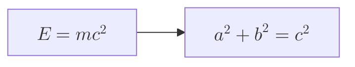

Use `PageMermaidCLI`, or the command's default page, for ZenUML. The [website gallery](https://bvolpato.github.io/mermaid-go-renderer/#gallery) has a rendered preview:

```text
zenuml
  Client->API: Request
  API->Database: Query
```

The fonts of `PageMermaidCLI` are part of the module. To get the file of `mmdc` from the library:

```go
svg, err := mermaid.Render(src, mermaid.WithPage(mermaid.PageMermaidCLI))
file, err := mermaid.StandaloneSVG(svg,
	mermaid.WithPage(mermaid.PageMermaidCLI),
	mermaid.WithBackgroundColor("white"),
	mermaid.WithFontEmbed(true),
)
```

## Diagram types

All diagram types of mermaid 12.2.0 render: flowchart, sequence, class, state, entity relationship, requirement, gantt, pie, quadrant, xychart, gitGraph, journey, timeline, mindmap, C4, sankey, block, packet, radar, treemap, kanban, architecture, venn, ishikawa, cynefin, wardley, treeView, usecase, swimlane, agentflow, railroad (four syntaxes), eventmodeling and info.

All layouts are supported: dagre, ELK, cose-bilkent, fcose and swimlanes, and `tidy-tree` in the page of `mmdc`. All looks (`classic`, `neo`, `handDrawn`) and all themes are supported.

Not supported:

- Icon packs. The command options `--iconPacks` and `--iconPacksNamesAndUrls` are not supported.
- `securityLevel: sandbox`, which renders into an iframe.
- Click callbacks. They need a live page and do not change the SVG.

## How it works

Many packages under `internal/` port the code that produces Mermaid's browser output. Other packages run bundled KaTeX and ZenUML code or write PDF from vector paths. Tests compare renderer output with recorded results from upstream code.

- The diagram code of mermaid and its parsers.
- The layout engines: dagre, the layered algorithm of Eclipse ELK, and cytoscape for mindmap and architecture.
- A small browser engine for measurement: DOM, CSS cascade, font matching, HarfBuzz shaping with the arithmetic of Blink, the float geometry of Skia.
- The JavaScript semantics that decide bits: number formatting, object key order, the sort of V8, and `Math` functions with the results of Chromium.
- A rasterizer for PNG output that ports the software renderer of Skia.
- A PDF writer that emits vector paths and text without starting a browser.

Read [docs/ARCHITECTURE.md](docs/ARCHITECTURE.md) for the details.

## Development

```sh
go test ./...                          # package tests against recorded goldens
go test -run TestCorpusParity .        # the corpus against the reference hashes
go run ./cmd/parity                    # the corpus against reference SVG files, with the first difference
go run ./tools/fmacheck ./internal/... # no fused multiply-add in ported code
```

The website is in `website`. `go run ./tools/sitegen -out dist` builds it, with the corpus comparison, the gallery and the WebAssembly playground. A push to `main` publishes it.

The parity and performance numbers in the README, CLI document, and website come from repository data:

| Data | What updates it |
|---|---|
| `testdata/reference`: the hashes of the reference files, and which diagrams pass | `go test -run TestCorpusParity -update-parity .` |
| `docs/performance.json`: the performance | `node tools/reference/bench.mjs`, which measures mermaid, `mmdc` and `mmdg` on this machine |

`tools/update-docs.sh` then writes the tables of this README, the documents under `docs` and the images under `docs/assets` again. The website reads the same data when it is built.

The reference SVG files come from `tools/reference/oracle.mjs`, which runs mermaid 12.2.0 in headless Chromium, and from `tools/reference/oracle-linux.mjs`, which does the same in a Linux container. Only these tools need node and a browser. The library and its tests do not.

## Licenses

The original code of this repository is under the MIT license. See [LICENSE](LICENSE).

The MIT license does not replace the licenses of the code that was ported. The code is a port of mermaid and of the libraries and browser code that produce its output, so most packages are derivative works and keep the terms of their source:

- Most sources are under MIT, ISC, BSD or Apache-2.0 terms: mermaid, d3, dagre, cytoscape, roughjs, DOMPurify (taken under Apache-2.0), Skia, V8 and most of Chromium.
- `internal/elk` contains elkjs and a port of the layered algorithm of Eclipse ELK, which are under EPL-2.0.
- Parts of `internal/browser`, `internal/raster`, `internal/dom` and `internal/css` follow SVG, layout and CSS source files of Blink that are under LGPL-2.0-or-later. Every render uses this code. A program that contains this module and is given to others must meet the conditions of the LGPL for these files.
- The embedded Liberation fonts are under the SIL Open Font License 1.1.

[THIRD_PARTY_NOTICES.md](THIRD_PARTY_NOTICES.md) has the copyright lines and the license texts. [docs/PROVENANCE.md](docs/PROVENANCE.md) says which package comes from which source. [docs/LICENSE-AUDIT.md](docs/LICENSE-AUDIT.md) has the findings of the audit, the decisions that were made and the decisions that are open.
